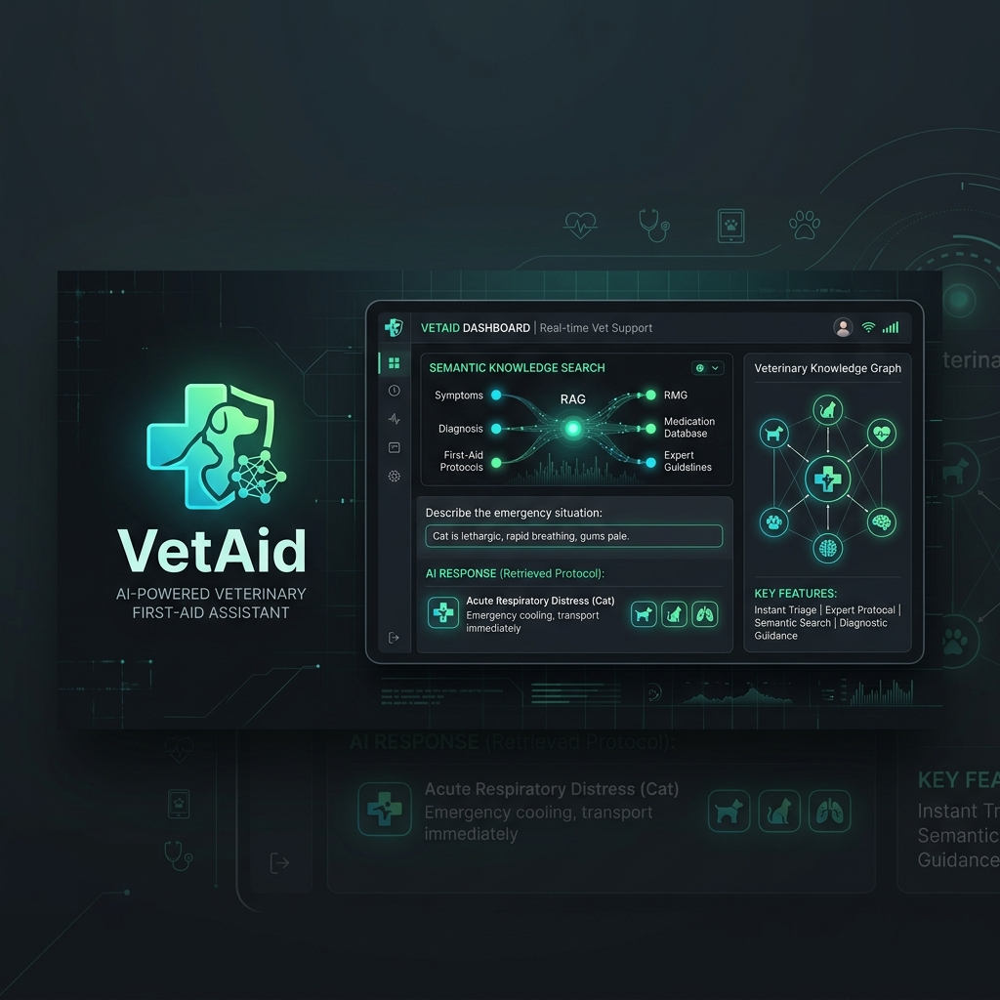
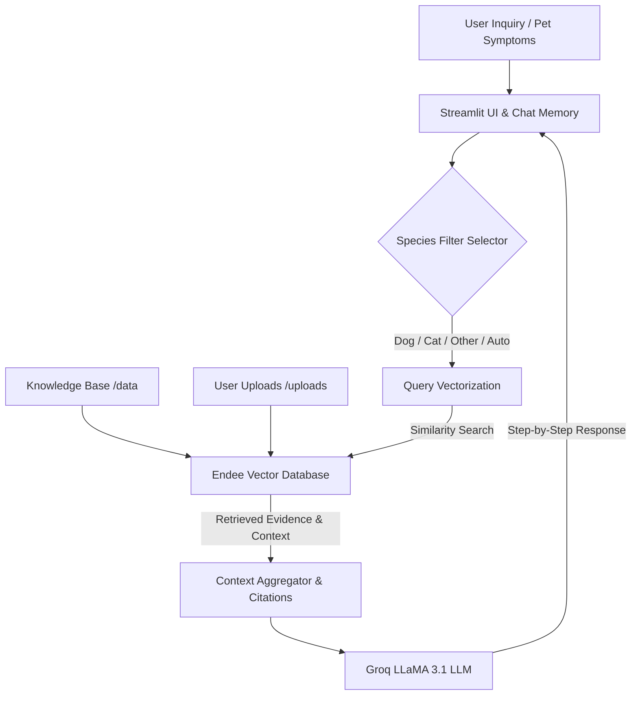

<p align="center">
  
</p>

<h1 align="center">🐾 VetAid | Veterinary First-Aid RAG Assistant</h1>

<p align="center">
  <strong>An AI-powered Retrieval-Augmented Generation (RAG) platform delivering calm, step-by-step first-aid guidance for critical pet emergencies.</strong>
</p>

<p align="center">
  <a href="https://python.org"></a>
  <a href="https://streamlit.io"></a>
  <a href="https://langchain.com"></a>
  <a href="https://groq.com"></a>
  <a href="https://endee.io"></a>
</p>

---

## 📖 Table of Contents
*   [🌟 Key Features](#-key-features)
*   [🛠️ System Architecture](#️-system-architecture)
*   [📂 Repository Structure](#-repository-structure)
*   [🚦 Getting Started](#-getting-started)
*   [📚 Knowledge Base](#-knowledge-base)
*   [⚠️ Emergency Disclaimer](#️-emergency-disclaimer)

---

## 🌟 Key Features

*   **⚡ Premium User Interface:** Sleek, modern Streamlit UI with adaptive light/dark mode styling, responsive typography, and clean information hierarchy.
*   **🧠 Conversational Memory:** Remembers details of the ongoing pet emergency so owners can ask natural follow-up questions.
*   **🔍 Grounded Answers with Citations:** Every guidance output provides inline citations and expandable source evidence drawn from the veterinary reference texts bundled in `data/`.
*   **🐈 Species-Aware Retrieval:** Dedicated search filters tailored for `Auto`, `Dog`, `Cat`, or `Other` animals, ensuring targeted treatment (e.g., dog-specific bloat vs. cat-specific blockages).
*   **📂 Multi-Source Library:** Automatically indexes all `.txt` and `.pdf` files in the core data folder, and supports dynamic, user-uploaded emergency procedures or PDFs.
*   **💾 Auto-Save & Download:** Saves your active chat session locally, lets you restore recent histories, and export markdown transcripts of the case.

---

## 🛠️ System Architecture

VetAid grounds LLaMA 3.1 responses in its bundled veterinary reference texts using semantic search retrieval over an [Endee](https://endee.io) vector database, instead of answering from the model's training data alone:



### How Endee is used

- **Indexing:** every knowledge-base chunk is embedded locally with `sentence-transformers/all-MiniLM-L6-v2` (384-dim) and upserted into an Endee collection (`cosine` space, `float32` precision) via the official Python SDK (`pip install endee`).
- **Retrieval:** each query is embedded and answered with an Endee vector search. The species selector maps to Endee's metadata filters (e.g. `species $in [dog, general]`), so filtering happens inside Endee itself.
- **Serving:** Endee runs either as a managed serverless database (free Starter plan at app.endee.io - no Docker) or self-hosted via Docker (one-command installer, free 1-month trial license). One collection is created per knowledge-base revision; old collections are pruned automatically.
- **Hybrid ranking:** Endee's dense results are fused with a local BM25 pass via Reciprocal Rank Fusion, then optionally re-ranked with a cross-encoder.
- The integration layer lives in [`endee_store.py`](endee_store.py) - a LangChain-compatible `VectorStore` implementation backed by Endee.

---

## 📂 Repository Structure

```text
vet_rag_project/
├── app.py              # Main Streamlit UI dashboard and chat manager
├── rag_pipeline.py     # Custom RAG engine (Endee + LangChain + Groq)
├── endee_store.py      # LangChain-compatible vector store backed by Endee
├── requirements.txt    # Package dependencies
├── README.md           # Visual setup and reference documentation
├── .env.example        # Environment variables configuration template
├── assets/             # Images and marketing graphics
│   └── vetaid_banner.png
├── data/               # Core veterinary knowledge base files
│   ├── vet_data.txt
│   ├── critical_emergencies.txt
│   ├── common_urgent_symptoms.txt
│   └── official_vet_emergency_reference.txt
├── endee_state/        # Per-dataset manifests + db tokens (gitignored)
├── chat_sessions/      # Local saved conversations (gitignored)
└── uploads/            # Temporary file upload stash (gitignored)
```

---

## 🚦 Getting Started

### 1. Prerequisites & Installation

Clone the repository and navigate into the project directory:

```bash
git clone https://github.com/Tayab-Ahamed/endee.git
cd endee/vetaid
```

Create a Python virtual environment and activate it:

```bash
# Windows
python -m venv .venv
.venv\Scripts\activate

# macOS / Linux
python3 -m venv .venv
source .venv/bin/activate
```

Install the required packages:

```bash
pip install -r requirements.txt
```

### 2. Connect an Endee database

VetAid stores and searches its vectors in Endee. Pick ONE route:

**Route A - Endee Serverless (free Starter plan, no Docker):**
1. Sign in at [app.endee.io](https://app.endee.io) (create an account if needed).
2. Create a database and choose the free **Starter** plan.
3. Copy the auth token the dashboard issues - the app needs it as `ENDEE_TOKEN`.

**Route B - Self-hosted (Docker required):**
```bash
curl -fsSL https://endee.io/install.sh | bash
```
The installer starts Endee at `http://localhost:8080` (API) and its Web UI at `http://localhost:8081`. Open the Web UI, generate a free 1-month trial license (emailed to you), and activate it. The app needs the root token you chose during installation as `ENDEE_ROOT_TOKEN`.

### 3. Configure Environment Variables

Copy the environment template and name it `.env`:

```bash
cp .env.example .env
```

Open `.env` and fill in your free Groq API key plus the Endee credential from your chosen route:

```env
GROQ_API_KEY=your_actual_groq_api_key_here
# Route A (serverless):
ENDEE_TOKEN=your_serverless_auth_token_here
# Route B (self-hosted) instead:
# ENDEE_ROOT_TOKEN=your_endee_root_token_here
# ENDEE_BASE_URL=http://localhost:8080/api/v2
# ENDEE_DB_NAME=vetaid
```
> 💡 *Get your Groq API key at [Groq Developer Console](https://console.groq.com).*

### 4. Run the Web Application

Launch the Streamlit dashboard:

```bash
streamlit run app.py
```
On the first run, VetAid embeds the veterinary knowledge base in `data/` and indexes it into your Endee server. Subsequent runs reuse the existing Endee collection instantly.

---

## 📚 Knowledge Base

VetAid's default RAG index is generated from curated veterinary emergency sources:
*   `vet_data.txt` — Core veterinary emergency symptoms and first-aid logic.
*   `critical_emergencies.txt` — Focused guidance for immediate action (Bloat/GDV, anaphylaxis, urinary blockages, safe trauma transport).
*   `common_urgent_symptoms.txt` — Red flags for breathing distress, toxic bites, seizure escalations, and eye trauma.
*   `official_vet_emergency_reference.txt` — Supplements curated from standard manuals (e.g., Merck Veterinary Manual, ASPCA Animal Poison Control, Red Cross Animal First Aid).

---

## ⚠️ Status & verification

This is a student project under active development. The Endee integration layer (`endee_store.py`) has been checked against the official `endee` Python SDK (v2.2.0) API contract, but the project has **not yet been exercised against a live Endee server** - the first real run may surface integration issues. VetAid is not a medical device and its guidance is not veterinary advice; see the Emergency Disclaimer below.

---

## 🙏 Attribution & licensing

- This repository is a fork of [endee-io/endee](https://github.com/endee-io/endee), created as the base for this project as required by the Endee ML internship application process. The upstream README and files remain at the repository root; the VetAid project lives entirely in this `vetaid/` directory. Endee is a commercial product of Endee (see the upstream README); this project only uses its public SDK and documented setup.
- VetAid is adapted from the author's original project [vetaid-rag-assistant](https://github.com/Tayab-Ahamed/vetaid-rag-assistant), replacing its ChromaDB retrieval layer with Endee. The original project carries no license file, so default copyright applies to the author's code and assets.

---

## ⚠️ Emergency Disclaimer

> [!WARNING]
> **VetAid is for emergency first-aid instruction and educational reference only. It is NOT a replacement for direct, professional veterinary care.**
>
> If a pet is collapsing, bleeding profusely, choking, experiencing repeated seizures, or unable to urinate, **transport them to an emergency veterinarian immediately.** Always consult a certified vet for medical diagnosis and treatment.
